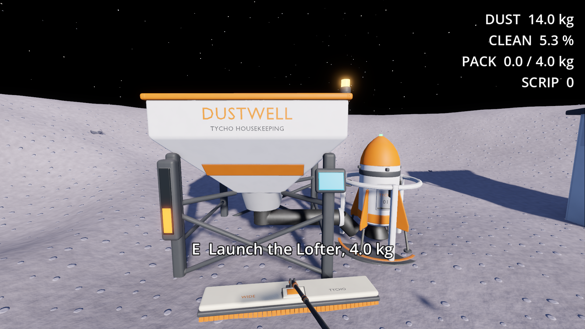

# Collect, Sell, Upgrade

Project files for tutorial 02 of the Spotless Moon series by Phaix on YouTube (https://www.youtube.com/@Phaix).

The loop of a moon cleaning game in Godot 4: a Dust Pack with a limit, a Dustwell you use with E, a Lofter that pays for every kilogram, and a Tool Locker that sells better tools and a bigger pack in order.



## Steps

Every step of the video is its own folder in `steps/`, the exact state at the end of that
part. Open the project in Godot 4.7, then open `steps/<step>/main.tscn` and press F6 to run
that step. The project's main scene is the final step.

| Folder | Part of the video |
|---|---|
| `steps/step_00_start` | Starting point (the final state of the previous tutorial) |
| `steps/step_01_pack` | Step 1 - The Dust Pack |
| `steps/step_02_dustwell` | Step 2 - The Dustwell |
| `steps/step_03_lofter` | Step 3 - The Lofter |
| `steps/step_04_locker` | Step 4 - The Tool Locker |
| `steps/step_05_round` | Step 5 - The whole round |

## Controls

- W A S D or the arrow keys walk, and so does the left stick of a gamepad.
- The mouse or the right stick looks around.
- Space or the A button jumps.
- Esc gives the mouse back, and a left click captures it again.
- Hold the left mouse button or the right trigger to brush the dust away.
- E or the X button uses the machine within reach (3.5 m of its middle), and the line at the bottom of the screen says what it will do.
- E works from `step_02_dustwell`.

## Tests

```sh
godot --headless --path . -s res://tests/run_tests.gd
```

## Support

Support the channel: https://ko-fi.com/phaix or https://github.com/sponsors/schemann

## License

Code and scenes: MIT (see LICENSE).
The brush sound (four cloth rustles): RPG Audio by Kenney (www.kenney.nl, https://kenney.nl/assets/rpg-audio), CC0, see sounds/CREDITS.md.
